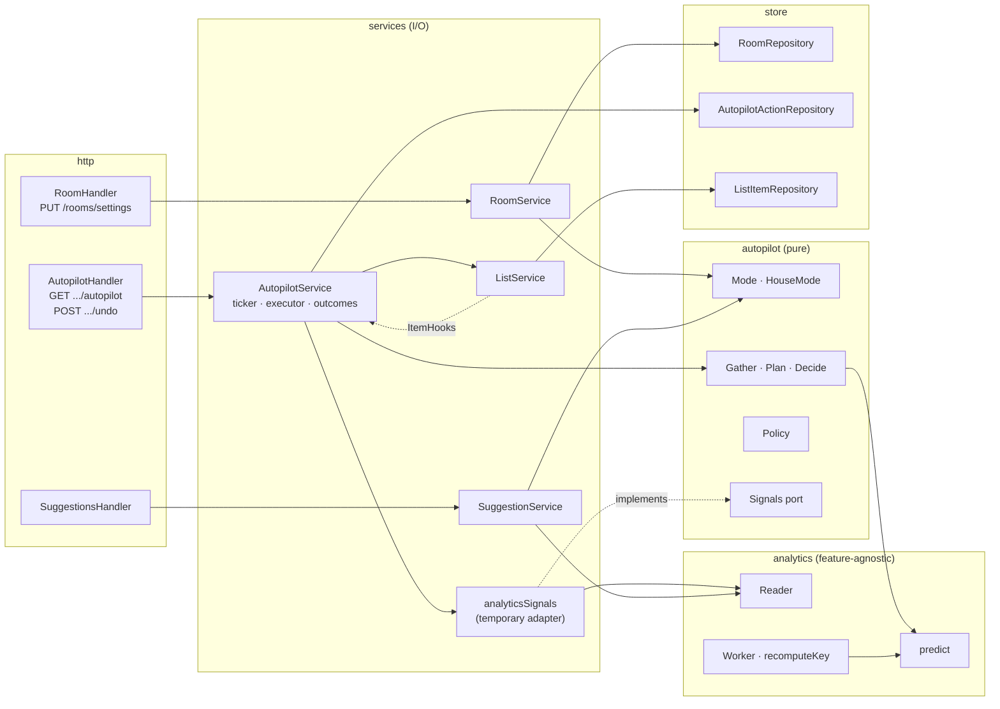
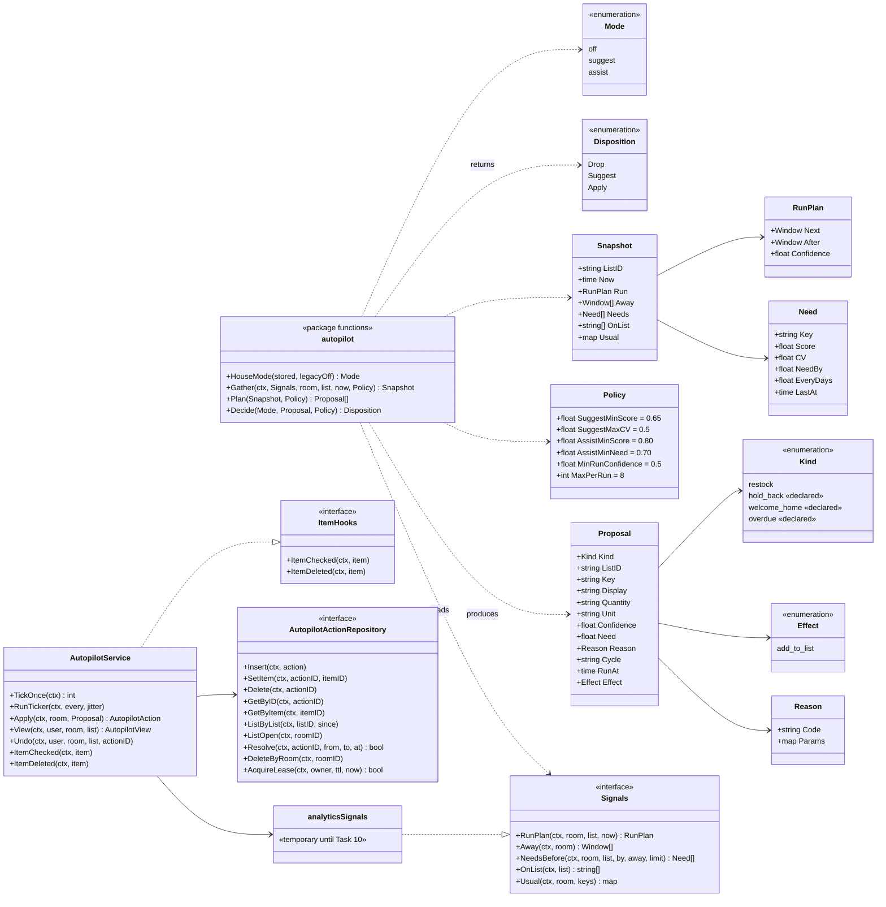
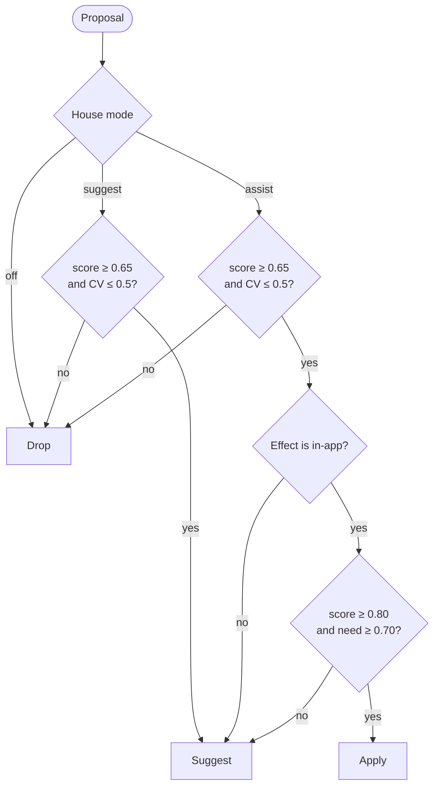
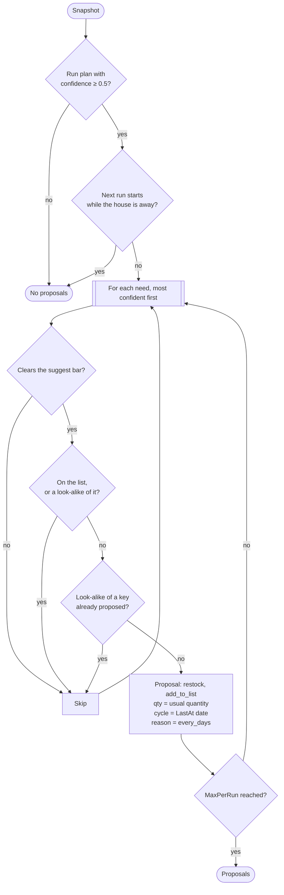
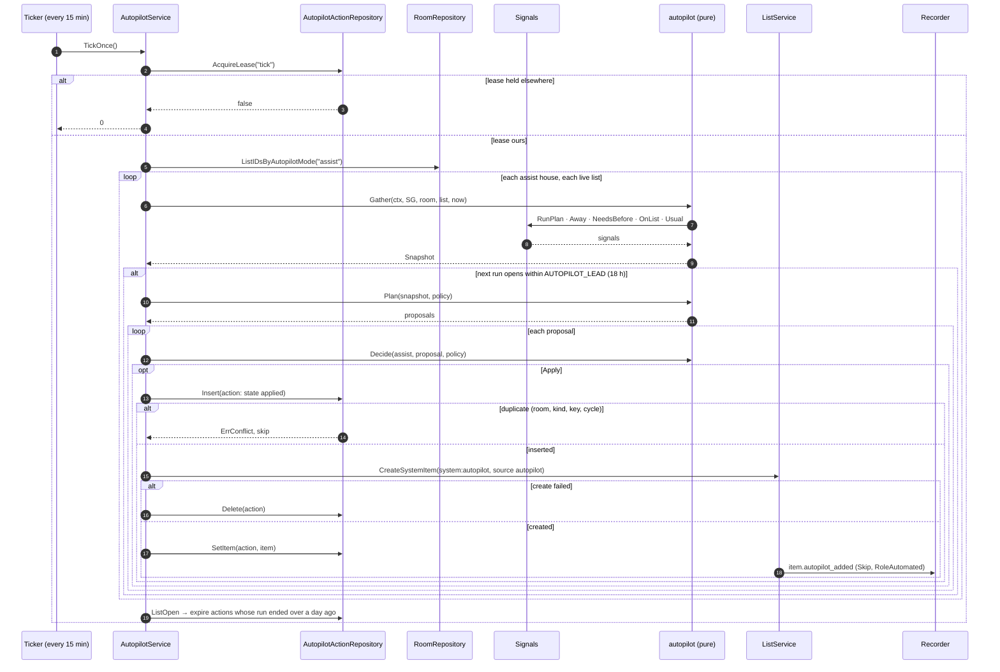
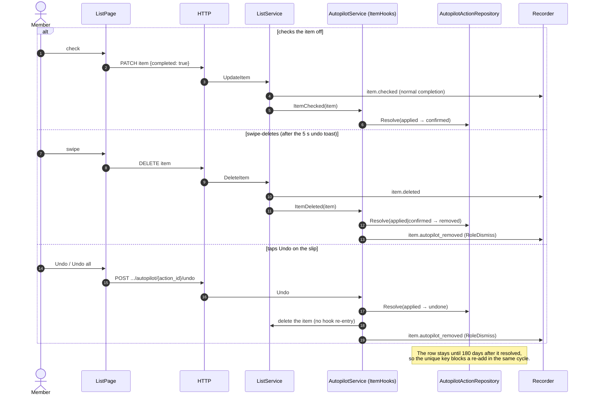
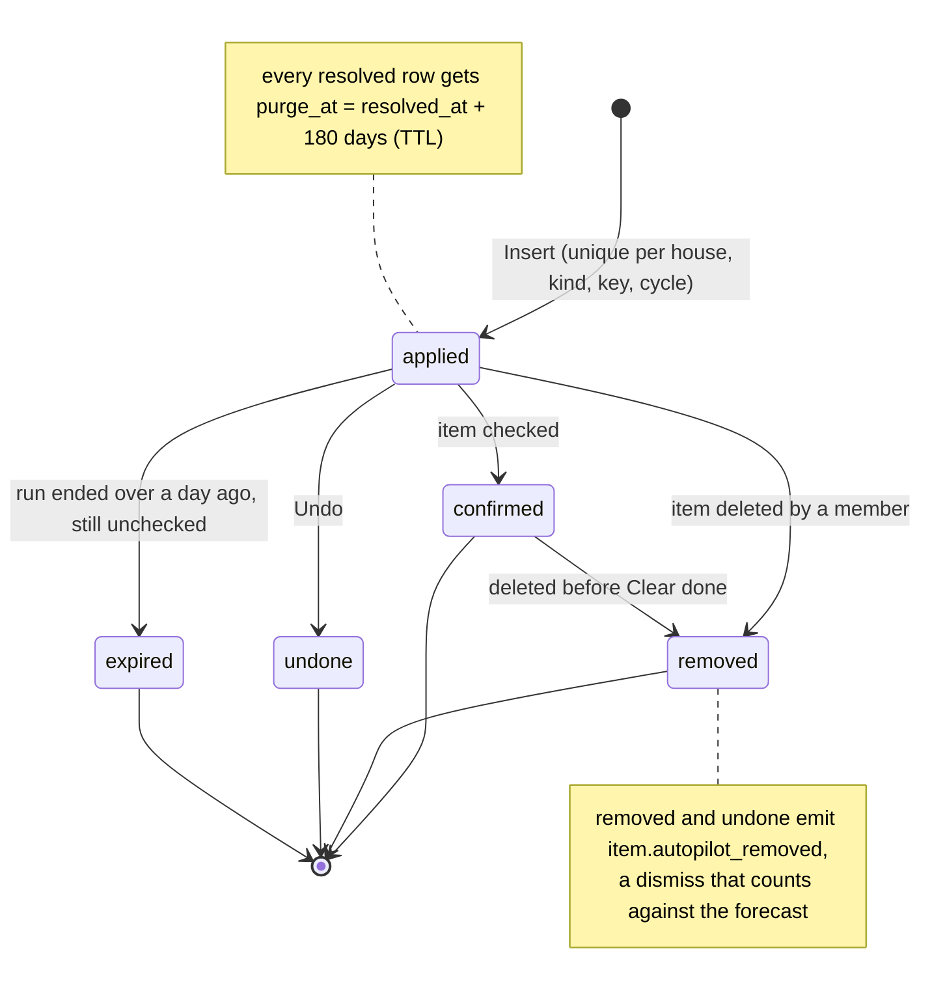
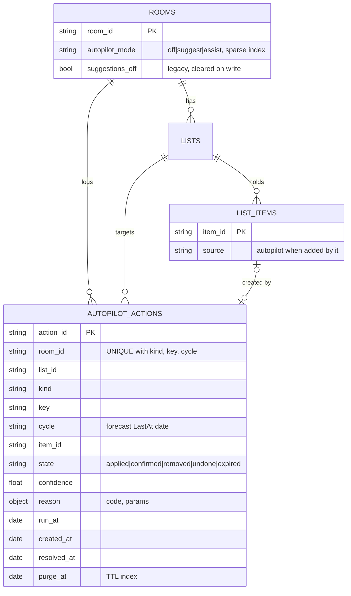
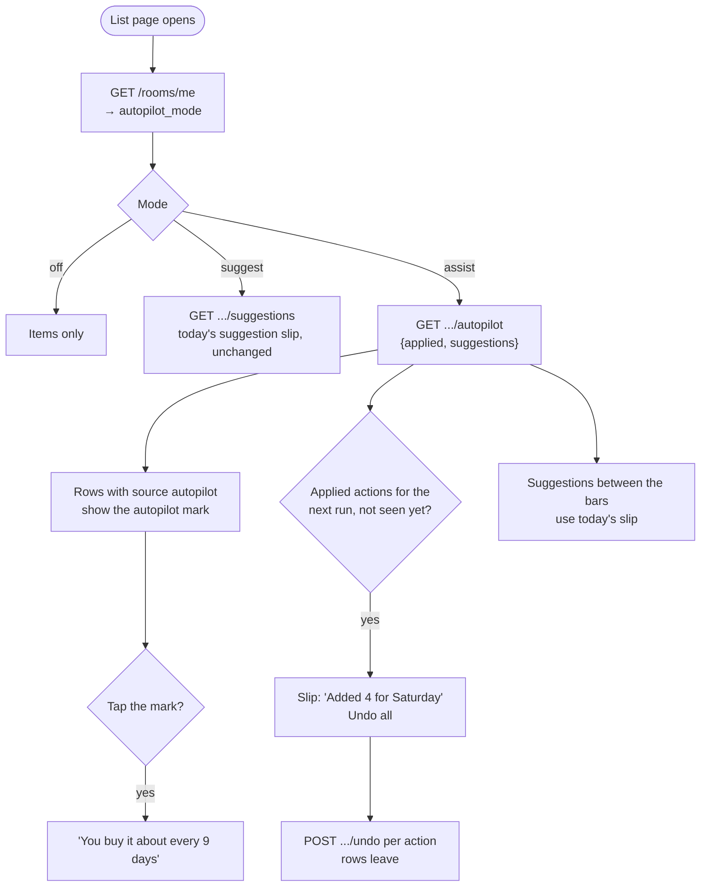

# Autopilot Engine Implementation Plan (v2)

> **For agentic workers:** REQUIRED SUB-SKILL: Use superpowers:subagent-driven-development (recommended) or superpowers:executing-plans to implement this plan task-by-task. Steps use checkbox (`- [ ]`) syntax for tracking.

**v2 changes (2026-10-17, Jan's review):** the server ceiling (`AUTOPILOT_MODE`) is gone. The house setting is the mode. The eval gate now tunes the assist bar instead of lowering a ceiling. Flow and UML diagrams added.

**Goal:** Let Bauhouse take the next in-app step for a house by itself (put the usual things on a list before the shop), with three house modes: `off`, `suggest` (today's suggestions, the default) and `assist` (reversible in-app actions, each with a reason and Undo). Full autopilot (buying, booking, messaging) is not a mode.

**Architecture:** A new pure package `internal/autopilot` holds the mode rules, the planner (`Plan(snapshot, policy) []Proposal`) and the policy (`Decide(mode, proposal, policy) Disposition`). It reads the world through a narrow `Signals` port that services implement: a temporary adapter over today's `analytics.Reader` now, and the anticipation API from `claude/analytics-anticipation` in Task 10. `services/autopilot_service.go` does the I/O. It gathers a snapshot, applies `Apply` proposals through `ListService` with an exact, durable action log (`autopilot_actions`, unique per house × kind × key × cycle), records outcomes from list hooks, and runs on a lease-based ticker. Suggest-mode proposals stay stateless, derived from events and aggregates as today. Analytics stays feature-agnostic: autopilot adds use a new generic `RoleAutomated` event role that never counts as a request.

**Tech Stack:** Go 1.26 + chi + MongoDB (memstore fakes for unit tests); React + Vite + TypeScript + React Query + Vitest + MSW.

**Spec:** this plan (Jan's brief, 2026-10-17). Sibling: `docs/superpowers/plans/2026-10-17-analytics-anticipation.md` on `claude/analytics-anticipation`.

## Global Constraints

- **The mode is a house setting.** `Room.AutopilotMode` is `off | suggest | assist`. Absent means `suggest`. A house with the legacy `Room.SuggestionsOff = true` reads as `off`. There is no data migration: the mapping happens at read time, and writing a mode clears `suggestions_off`. Any member may change it (like renaming the house); the change emits `house.settings_updated`. API responses keep `suggestions_off` for one release, derived from the mode. There is **no server ceiling**.
- `SUGGESTIONS_MODE` (the existing operator kill switch for computing suggestions) is untouched. It is not an autopilot mode and does not gate assist.
- **Never external:** `autopilot.Effect` has only in-app values (`EffectAddToList`), and the executor refuses anything else. External effects need a new mode and explicit consent (a comment at the type and at the executor says so).
- **Autopilot adds are never human requests.** `item.autopilot_added` is registered with `Skip: true`, `Role: RoleAutomated` and actor `system:autopilot`. `recomputeKey` forecasts a key from checks (`predict.SeriesChecked`) when an automated add falls in its recent cycles. Removing an autopilot item emits `item.autopilot_removed` (`RoleDismiss`, a real miss). Checking it off is a normal `item.checked`.
- **Stateless suggestions, durable actions:** suggest-mode proposals are derived from events and aggregates only. Only applied (assist) actions are stored, because the recorder may drop events and "did we already add this?" must be exact.
- **Bars by intrusiveness** (`autopilot.Policy`, tuned by Task 9's eval, not by feel): suggest = `Forecast.Confident` (MinScore 0.65, MaxCV 0.5). Assist = score ≥ 0.80 **and** need-before-the-run-after-next ≥ 0.70. Between the bars, assist falls back to a suggestion.
- `ForecastVersion` → **4** (the analytics branch takes 3).
- `internal/autopilot` imports only pure code (`analytics/predict`, `parse`). It never imports `store`, `services` or Mongo, and `internal/analytics` never imports `autopilot`.
- UI: tokens and primitives only (`Paper`, `Button`, `Sheet`, slips). A new mark goes into the system first (token block, `pnpm design:sync`, reference page, DESIGN.md). Voice: plain, warm, short ("Added 4 for Saturday").
- Run `make check` before each commit and `make test-integration` for the Mongo tasks (1 and 4). Commits end with `Co-Authored-By: Claude Opus 5.5 <noreply@anthropic.com>`.

## Review Focus

- Autopilot adds never count as requests; a house on assist for 10 cycles keeps a stable rhythm. → `TestAutomatedAddsKeepRhythm` (analytics), `TestAssistTenCyclesStableRhythm` (services).
- `off` produces nothing, `suggest` never writes, `assist` writes only in-app and only above the assist bar; between the bars it falls back to a suggestion. → `TestDecideModesByBand`, `TestTickWritesOnlyInAssist`, `TestExecutorRefusesExternalEffects`.
- Two instances ticking at once add an item once. → `TestConcurrentTicksAddOnce` (service), `TestAutopilotActionUniqueKey` (Mongo).
- Undo and swipe-delete both mark the action removed and feed a dismiss; the item does not come back in the same cycle. → `TestUndoMarksUndoneAndDismisses`, `TestDeleteAutopilotItemMarksRemoved`, `TestRemovedNotReaddedSameCycle`.
- An item already on the list (or a look-alike, `parse.Similarity`) is never added again. → `TestPlanSkipsOnListAndLookAlikes`.
- A house that is away gets no assist adds for the away period. → `TestPlanAwayNoAdds` (fake away calendar until Task 10).
- Suggest mode behaves exactly like today's suggestions. → `TestForListParityAcrossModes`.

## Diagrams

### 1. Components and dependencies

Arrows point from the importer to what it imports. `autopilot` is pure; services do every read and write.



### 2. Package model (UML class diagram)



### 3. Deciding one proposal (`Decide`)



### 4. Planning one list (`Plan`, restock rule)



### 5. One tick (UML sequence)

Every instance runs the ticker. The lease keeps the work on one instance, and the unique action key makes a second write a no-op even if two instances race.



### 6. Outcomes: check, swipe-delete, Undo (UML sequence)



### 7. Action lifecycle (UML state machine)



### 8. Keeping the forecast honest (`recomputeKey`)


Why: on assist, nobody adds the thing by hand any more, so the add series would dry up and the forecast would decay (or, if autopilot adds counted, confirm itself). Completions keep coming either way.

### 9. Data model (`autopilot_actions`)



A separate `autopilot_state` collection holds the ticker lease (`_id: "tick"`, `owner`, `lease_until`).

### 10. List page (frontend flow)



---

### Task 1: Modes

**Files:**
- Create: `backend/internal/autopilot/mode.go`, `mode_test.go`
- Modify: `backend/internal/models/room.go`, `backend/internal/store/repo.go` (`RoomRepository.SetAutopilotMode`, `ListIDsByAutopilotMode`; remove `SetSuggestionsOff`), `backend/internal/store/mongo/room_repo.go` (+ sparse index), `backend/internal/testutil/memstore/memstore.go`, `backend/internal/services/room_service.go` (`RoomSettings`), `backend/internal/http/handlers/room.go`
- Test: `autopilot/mode_test.go`, `handlers/autopilot_mode_test.go`, `store/mongo/mongo_integration_test.go`

**Interfaces:**
```go
type Mode string // ModeOff, ModeSuggest, ModeAssist
func ParseMode(s string) (Mode, bool)
func HouseMode(stored string, legacyOff bool) Mode
// models.Room: AutopilotMode string `bson:"autopilot_mode,omitempty" json:"-"`
// RoomRepository: SetAutopilotMode(ctx, roomID, userID, mode string, at time.Time) error  (clears suggestions_off)
//                 ListIDsByAutopilotMode(ctx, mode string, limit int) ([]string, error)
type RoomSettings struct{ DisplayName, Description *string; SuggestionsOff *bool; AutopilotMode *autopilot.Mode }
func (s *RoomService) UpdateRoomSettings(ctx, user, in RoomSettings) error
```
- [ ] Failing tests: `ParseMode` table (tolerates case and spaces; unknown → false); `HouseMode("", true)` = off, `("", false)` = suggest, `("assist", true)` = assist. Handler: `PUT /rooms/settings {autopilot_mode:"bogus"}` → 400; `{autopilot_mode:"assist"}` → 200, then `GET /rooms/me` → `autopilot_mode:"assist", suggestions_off:false`; `{suggestions_off:true}` reads back `off`; `{suggestions_off:false}` turns off → suggest and never downgrades assist. Mongo: setting a mode unsets `suggestions_off`; `ListIDsByAutopilotMode("assist")`; a non-member write → `ErrNotFound`.
- [ ] Implement; `house.settings_updated` lists `autopilot_mode`.
- [ ] `make check`, `make test-integration`. Commit `feat(rooms): autopilot mode as a house setting`.

### Task 2: Gate today's suggestions through the mode

**Files:** `services/suggestion_service.go`, `services/run_hint.go`; tests in `services/suggestion_service_test.go`.
- [ ] Failing tests: `TestForListParityAcrossModes` (the same fixture returns identical suggestions for no stored mode, `suggest` and `assist`; nothing for `off` or legacy `suggestions_off`); the run hint falls back to the default under `off`.
- [ ] Replace the `room.SuggestionsOff` checks with `autopilot.HouseMode(...) == ModeOff`.
- [ ] `make check`. Commit `feat(suggestions): gate suggestions and the run hint by autopilot mode`.

### Task 3: Planner core (pure)

**Files:** create `autopilot/proposal.go`, `policy.go`, `plan.go`, `signals.go`, `need.go` (+ tests), `autopilot/autopilottest/fake.go`.

**Interfaces:** as in diagram 2, plus
```go
var DefaultPolicy = Policy{SuggestMinScore: 0.65, SuggestMaxCV: 0.5, AssistMinScore: 0.80, AssistMinNeed: 0.70, MinRunConfidence: 0.5, MaxPerRun: 8}
func ApproxNeedBy(lastAt, dueAt time.Time, everyDays, cv float64, confident bool, by time.Time) float64 // until predict.NeedBy lands
```
The restock rule is diagram 4; `Decide` is diagram 3.
- [ ] Failing table tests: `TestDecideModesByBand` (off/suggest/assist × below suggest / between / above assist / high score but low need / non-in-app effect); `TestPlanSkipsOnListAndLookAlikes`; `TestPlanAwayNoAdds`; `TestPlanCycleIsLastAtDate`; `TestPlanNoRunNoProposals`; `TestApproxNeedBy` (≈0.5 at due, ≥0.95 far past, ~0 at last, a step at CV 0, ≤0.5 when not confident).
- [ ] `make check`. Commit `feat(autopilot): pure planner, policy and signals port`.

### Task 4: Action log store (Mongo)

**Files:** create `models/autopilot_action.go`, `store/mongo/autopilot_repo.go`, `testutil/memstore/autopilot.go`, `store/mongo/autopilot_integration_test.go`; modify `store/repo.go`, `services/room_service.go`, `services/user_service.go` (delete with the house).

**Interfaces:** `AutopilotActionRepository` as in diagram 2; data as in diagram 9. `Insert` returns `derr.ErrConflict` on the unique key; `Resolve` is conditional on the `from` states and sets `purge_at`.
- [ ] Failing integration tests: `TestAutopilotActionUniqueKey`; conditional resolve (applied→confirmed true; undone→removed false); TTL index on `purge_at`; `DeleteByRoom`; the lease is exclusive between two owners. The memstore mirrors every rule.
- [ ] `make check`, `make test-integration`. Commit `feat(autopilot): durable action log with a unique action key`.

### Task 5: Executor and outcomes

**Files:** create `services/autopilot_service.go` (+ test); modify `models/list_item.go` (`Source string json:"source,omitempty"`), `services/list_service.go` (`CreateSystemItem`, `UseItemHooks`), `services/analytics_events.go`, `analytics/registry.go` (`RoleAutomated`), `analytics/rollup.go`, `analytics/predict/forecast.go` (`PredictChecked`), `analytics/aggregate.go` (`ForecastVersion = 4`).

Flows: diagrams 5 (apply path), 6, 7 and 8.
- [ ] Failing tests: `TestExecutorRefusesExternalEffects`; `TestApplyInsertsThenCreatesItem` (source `autopilot`, actor `system:autopilot`, only `item.autopilot_added`, no `item.added`); `TestApplyDuplicateIsNoop`; check → confirmed; `TestDeleteAutopilotItemMarksRemoved` (+ `item.autopilot_removed`); `TestRemovedNotReaddedSameCycle`; `TestAutomatedAddsKeepRhythm` (rollup: weekly checks, adds replaced by automated ones → series checked, still confident); `TestAssistTenCyclesStableRhythm`.
- [ ] `make check`. Commits `feat(analytics): automated role, forecast from checks for automated keys` and `feat(autopilot): executor and outcome hooks`.

### Task 6: When it runs

**Files:** `services/autopilot_service.go` (ticker, view, undo), `http/handlers/autopilot.go` (+ test), `http/router/router.go`, `config/config.go` (`AUTOPILOT_TICK_EVERY` 15m, `AUTOPILOT_LEAD` 18h), `cmd/gracie-server/main.go`, `.env.example`.

```go
// GET  /rooms/{room_id}/lists/{list_id}/autopilot → {mode, applied: [...], suggestions: [...]}  (never applies)
// POST /rooms/{room_id}/lists/{list_id}/autopilot/{action_id}/undo → 204
```
The tick is diagram 5. It only visits houses that stored `assist`, and the house mode is re-read per house so a switch to off stops it at once.
- [ ] Failing tests: `TestTickWritesOnlyInAssist`; `TestTickOutsideLeadDoesNothing`; `TestConcurrentTicksAddOnce` (two services, one store, parallel ticks); `TestTickExpiresStaleActions`; `TestViewNeverApplies`; `TestUndoMarksUndoneAndDismisses`; handler auth (403 for another house, 404 for an unknown action).
- [ ] `make check`. Commit `feat(autopilot): lease-based ticker, read view and undo`.

### Task 7: Frontend settings

**Files:** `frontend/src/pages/RoomSettings.tsx` (+ test), `api/types.ts`, `api/endpoints.ts`; a `Segmented` primitive in `components/ui/` if none exists (reference page, DESIGN.md, `/dev/ui`).
- [ ] Failing test: the three options render as a radio group; picking Assist PUTs `{autopilot_mode:"assist"}` and shows "Adds things to your lists before you shop. You can always undo. It never buys or books anything."
- [ ] `make check`. Commit `feat(settings): three-way autopilot control`.

### Task 8: Frontend list

**Files:** `components/ItemRow.tsx`, `pages/ListPage.tsx`, a new `AutopilotSlip`, `styles.css` token(s) for the autopilot mark, `docs/design-system/index.html`, `DESIGN.md`, the MSW mock (autopilot items + endpoint). Flow: diagram 10.
- [ ] Failing tests: an item with `source:"autopilot"` shows the mark; tapping it shows the reason; the slip reads "Added 4 for Saturday" once per run; Undo all posts one undo per action and removes the rows; suggest mode keeps today's slip.
- [ ] Check it in `VITE_MOCK_TRIPS=1 pnpm dev`. `make check`. Commit `feat(lists): autopilot mark, reason and the added-for slip`.

### Task 9: Eval

**Files:** create `autopilot/replay.go` (+ test); modify `cmd/suggest-eval/main.go` (`autopilot` subcommand).

`func Replay(events []analytics.Event, p Policy, lead time.Duration) ReplayReport` with `Precision()`, `Recall()` and `RemovalsPerWeek()`. At each past run minus the lead, plan from the data before that time. An auto-added item counts as a hit when it was checked in that run, and as a removal otherwise.
- [ ] Failing tests on a synthetic weekly house (precision 1, recall 1, 0 removals) and a noisy one.
- [ ] Run on the dev dataset and sweep `AssistMinScore` / `AssistMinNeed`. **Gate:** pick the loosest bar with precision ≥ 0.85 and removals ≤ 1 per week. If no bar meets it, keep 0.80 / 0.70, say so in the PR, and Jan decides whether Assist ships in the settings control. The numbers go in the PR description.
- [ ] `make check`. Commit `feat(autopilot): suggest-eval autopilot replay`.

### Task 10: Wire the real analytics (follow-up PR, after `claude/analytics-anticipation` merges)

Rebase onto `main`. Implement `Signals` with `Reader.RunPlan`, `Reader.NeedsBefore`, `predict.NeedBy` and the `AwayCalendar`; delete the temporary adapter and `ApproxNeedBy`; keep the test fakes. Commit `feat(autopilot): read anticipation signals from analytics`.

### Task 11: Docs

`docs/features/autopilot.md` (modes table, invariants, eval gate, these diagrams) plus a row in `docs/features/README.md`. Update `suggestions.md`, `lists.md` and `backend/CLAUDE.md` (the stateless-suggestions invariant now names the action log). Commit `docs(autopilot): feature note and invariants`.

## Out of scope

Holding perishables back before a trip, the welcome-home shop and overdue chores (the kinds are declared only), push notifications, and any external effect.
