# Autopilot Engine Implementation Plan (v4)

> **For agentic workers:** REQUIRED SUB-SKILL: Use superpowers:subagent-driven-development (recommended) or superpowers:executing-plans to implement this plan task-by-task. Steps use checkbox (`- [ ]`) syntax for tracking.

**Changes**
- **F1 ship bar (2026-10-17, Jan):** assist ships only at F1 ≥ 70% (precision × open recall) on top of the gate.
  The add forecast was the wrong measure for assist (it times *adds*; assist needs *purchases per run*), so
  assist now judges each thing by its **run fit** (`autopilot.FitRun`/`Assess`: run score and need from its own
  check-offs against the run rhythm), the assist and suggest bars are independent in `Decide`, look-alikes are
  judged before they are merged, and the bar is run score ≥ 0.50, need ≥ 0.60. F1 52.6% → 77.7% at 97.8%
  precision; hold-out seeds 76.7–78.9%.
- **Exclusive modes (2026-10-17, Jan):** a mode cannot be both. Assist never suggests: "if it's good enough to
  suggest, it should be applied in assist mode". Assist adds what either bar picks (`AssistOpen`: what Suggest
  would show, then run-fit picks; `Proposal.Basis`), `Decide` in assist never returns Suggest, the suggestions
  endpoint answers with nothing on assist, and the List page never asks for suggestions there. F1 77.7% → 76.1%
  (precision 83.9%, open recall 69.6%); the precision gate is 75%, the F1 floor 0.76. Diagrams 4 and 11 show it;
  the bullets below about falling back to a suggestion are superseded.
- **As built (2026-10-17):** deleting an item already checked off is tidying, not a miss, so only an *applied*
  action can become removed (diagrams 7 and 8). An unchecked item expires 30 h after its run started. The
  benchmark (`docs/superpowers/qa/autopilot-benchmark-2026-10-17.md`) passes the gate at the default bar,
  which stays at 0.80 / 0.70: the loosest passing bar (0.70 / 0.50) adds almost nothing.
- **v4 (2026-10-17):** the analytics anticipation upgrade is on `main` (janvillarosa/gracie-app#28), and this branch is rebased onto it. The planner reads the real signals from day one: `Reader.RunPlan`, `Reader.NeedsBefore` (which applies `predict.NeedBy`), `Reader.Upcoming` and the `analytics.AwayCalendar` port (`services.AwayCalendar`). There is no temporary adapter, no `ApproxNeedBy`, and the house is away-aware from the first assist add. The old Task 10 is gone (11 tasks become 10). `ForecastVersion` on `main` is 3, so this branch takes 4. Tests and the eval use the golden households (`internal/testutil/households`).
- **v3:** one service and one candidate pipeline. `SuggestionService` is folded into `AutopilotService`, with no wrapper left behind. The handlers call `AutopilotService` directly. The existing routes (`…/suggestions`, `…/suggestions/ignore`, `…/run-hint`) keep their paths and are marked deprecated in favour of `…/autopilot`. The candidate filters move into the pure `autopilot` package, so the slip, run mode and Assist all judge the same items. The run hint moves into the same service.
- **v2:** no server ceiling (the house setting is the mode); the eval gate tunes the assist bar; diagrams added.

**Goal:** Let Bauhouse take the next in-app step for a house by itself (put the usual things on a list before the shop), with three house modes: `off`, `suggest` (today's suggestions, the default) and `assist` (reversible in-app actions, each with a reason and Undo). Full autopilot (buying, booking, messaging) is not a mode.

**Architecture:** One feature, one service, one pipeline. The pure package `internal/autopilot` holds the mode rules, the candidate filters, the planner (`Plan(snapshot, policy) []Proposal`) and the policy (`Decide(mode, proposal, policy) Disposition`). It reads the world through a narrow `Signals` port. `services/autopilot_service.go` is the only service. It gathers a snapshot through `Signals`, implemented by `services/autopilot_signals.go` over `analytics.Reader` (`RunPlan`, `NeedsBefore`, `Upcoming`, `HouseProfile`), the event repository and the `analytics.AwayCalendar` port. Then it runs `Plan` and `Decide`, and then shows a suggestion or applies an action. Three callers share the pipeline and differ only in **horizon**: the suggestion slip asks for what is due now, run mode for what comes due before the next run, and the Assist ticker for what is needed before the run after next. Only applied actions are stored, in a durable action log (`autopilot_actions`, unique per house × kind × key × cycle), so suggestions stay stateless. Analytics stays feature-agnostic: autopilot adds use a new generic `RoleAutomated` event role that never counts as a request.

**Tech Stack:** Go 1.26 + chi + MongoDB (memstore fakes for unit tests); React + Vite + TypeScript + React Query + Vitest + MSW.

**Spec:** this plan (Jan's brief and review, 2026-10-17). Builds on `docs/superpowers/plans/2026-10-17-analytics-anticipation.md` (merged in janvillarosa/gracie-app#28) and `docs/features/analytics.md`.

## Global Constraints

- **The mode is a house setting.** `Room.AutopilotMode` is `off | suggest | assist`. Absent means `suggest`. A house with the legacy `Room.SuggestionsOff = true` reads as `off`. There is no data migration: the mapping happens at read time, and writing a mode clears `suggestions_off`. Any member may change it (like renaming the house); the change emits `house.settings_updated`. API responses keep `suggestions_off` for one release, derived from the mode. There is no server ceiling.
- `SUGGESTIONS_MODE` (the existing operator kill switch) is untouched: `off` still stops the service from computing anything for any house. It is not an autopilot mode.
- **One service.** `SuggestionService` is removed. `AutopilotService` serves suggestions, ignores, the run hint, the read view, Undo, the executor, the outcome hooks and the ticker.
- **Deprecated routes, same paths.** `GET …/lists/{id}/suggestions`, `POST …/suggestions/ignore` and `GET …/lists/{id}/run-hint` keep their paths and responses. Their handlers call `AutopilotService` directly and set `Deprecation: true` plus `Link: <…/autopilot>; rel="successor-version"`. A comment on each route and a line in `docs/features/autopilot.md` say they go once the List page reads `GET …/autopilot` for everything.
- **One candidate pipeline.** The filters that decide what may be proposed (home list, not on the list or a look-alike of it, one name per look-alike cluster, cycle still open, list not paused by two ignores in a row, ordering) live once, in `autopilot`. Suggest mode must behave exactly like today: every existing suggestion test passes unchanged in meaning.
- **Never external:** `autopilot.Effect` has only in-app values (`EffectAddToList`), and the executor refuses anything else. External effects need a new mode and explicit consent (a comment at the type and at the executor says so).
- **Autopilot adds are never human requests.** `item.autopilot_added` is registered with `Skip: true`, `Role: RoleAutomated` and actor `system:autopilot`. `recomputeKey` forecasts a key from checks (`predict.SeriesChecked`) when an automated add falls in its recent cycles. Removing an autopilot item emits `item.autopilot_removed` (`RoleDismiss`, a real miss). Checking it off is a normal `item.checked`.
- **Stateless suggestions, durable actions:** suggestions are derived from events and aggregates only (the `item.suggestion_predicted` measurement records stay as they are). Only applied (assist) actions are stored, because the recorder may drop events and "did we already add this?" must be exact.
- **Bars by intrusiveness** (`autopilot.Policy`, tuned by Task 9's eval, not by feel): suggest = `Forecast.Confident` (MinScore 0.65, MaxCV 0.5). Assist = run fit score ≥ 0.50 **and** need ≥ 0.60 (as built; the first draft used the add forecast at 0.80 / 0.70). What assist does not apply but clears the suggest bar is suggested.
- `ForecastVersion` goes 3 → **4** in Task 5 (the automated role changes which series a key forecasts from); `RefreshStale` rebuilds every key, no backfill needed.
- **Signals come from analytics, never around it.** Run plans: `Reader.RunPlan(room, "list:<id>", now)` (`Next`, `After`, both stepped in home time). Need: `Reader.NeedsBefore(room, "list:<id>", by, away, limit)`, whose `P` is `predict.NeedBy` (log-normal on the forecast's own clock, capped at 0.5 unless the forecast is confident). Away spans: `AwayCalendar.HouseAway(room)` (a house is away only when every member is). The slip's "now" horizon keeps reading `Reader.Upcoming` exactly as today, so suggest mode is unchanged.
- **Automated actors stay out of people's stats.** `system:autopilot` is a `system:*` actor, so `isRealUser`, `LastBy` and `Turns` already ignore it; a test pins that.
- **Tests use the golden households** (`internal/testutil/households`: ten seeded personas, including weekend shoppers, frequent travellers and a new house) wherever a realistic history is needed.
- `internal/autopilot` imports only pure code (`analytics/predict`, `parse`). It never imports `store`, `services` or Mongo, and `internal/analytics` never imports `autopilot`.
- UI: tokens and primitives only (`Paper`, `Button`, `Sheet`, slips). A new mark goes into the system first (token block, `pnpm design:sync`, reference page, DESIGN.md). Voice: plain, warm, short ("Added 4 for Saturday").
- Run `make check` before each commit and `make test-integration` for the Mongo tasks (1 and 4). Commits end with `Co-Authored-By: Claude Opus 5.5 <noreply@anthropic.com>`.

## Review Focus

- Autopilot adds never count as requests; a house on assist for 10 cycles keeps a stable rhythm. → `TestAutomatedAddsKeepRhythm` (analytics), `TestAssistTenCyclesStableRhythm` (services, a golden household's weekend shopper), `TestAutopilotActorNotATurn`.
- `off` produces nothing, `suggest` never writes, `assist` writes only in-app and only above the assist bar; between the bars it falls back to a suggestion of the same item. → `TestDecideModesByBand`, `TestTickWritesOnlyInAssist`, `TestExecutorRefusesExternalEffects`, `TestAssistFallbackIsSameItem`.
- Two instances ticking at once add an item once. → `TestConcurrentTicksAddOnce` (service), `TestAutopilotActionUniqueKey` (Mongo).
- Undo and swipe-delete both mark the action removed and feed a dismiss; the item does not come back in the same cycle. → `TestUndoMarksUndoneAndDismisses`, `TestDeleteAutopilotItemMarksRemoved`, `TestRemovedNotReaddedSameCycle`.
- An item already on the list (or a look-alike, `parse.Similarity`) is never added again. → `TestPlanSkipsOnListAndLookAlikes`.
- A house that is away gets no assist adds for the away period. → `TestPlanAwayNoAdds` (pure, fake signals) and `TestTickSkipsHouseAway` (service, a real trip through `services.AwayCalendar`).
- Suggest mode behaves exactly like today's suggestions. → the existing suggestion suite, ported to `AutopilotService` with only names changed, plus `TestSuggestionsParityAcrossModes`.
- The deprecated routes answer exactly as before. → the existing handler tests stay green, plus `TestDeprecatedRoutesCarryHeader`.

## Diagrams

### 1. Components and dependencies

Arrows point from the importer to what it imports. `autopilot` is pure; `AutopilotService` does every read and write.

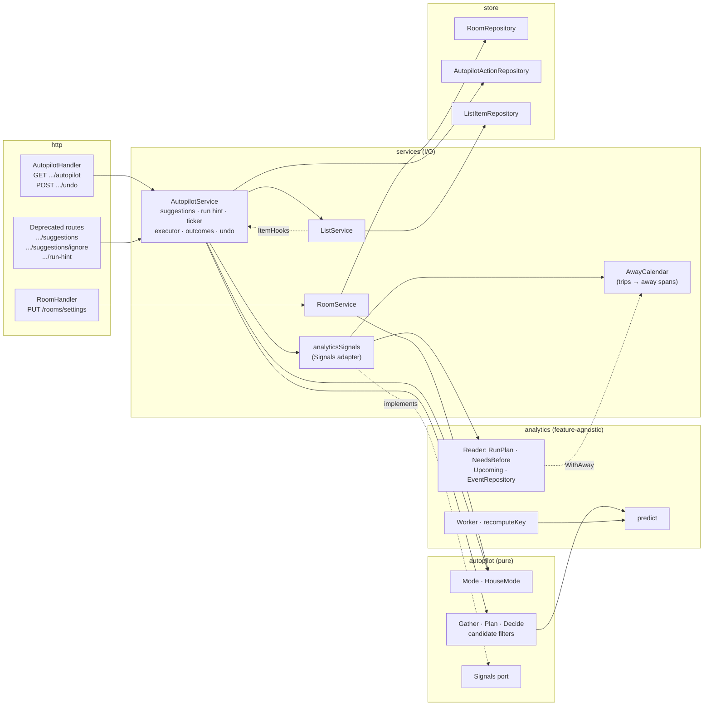

### 2. One pipeline, three callers

Every caller goes through the same filters and the same `Decide`; only the horizon differs.

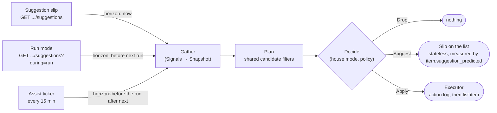

### 3. Package model (UML class diagram)

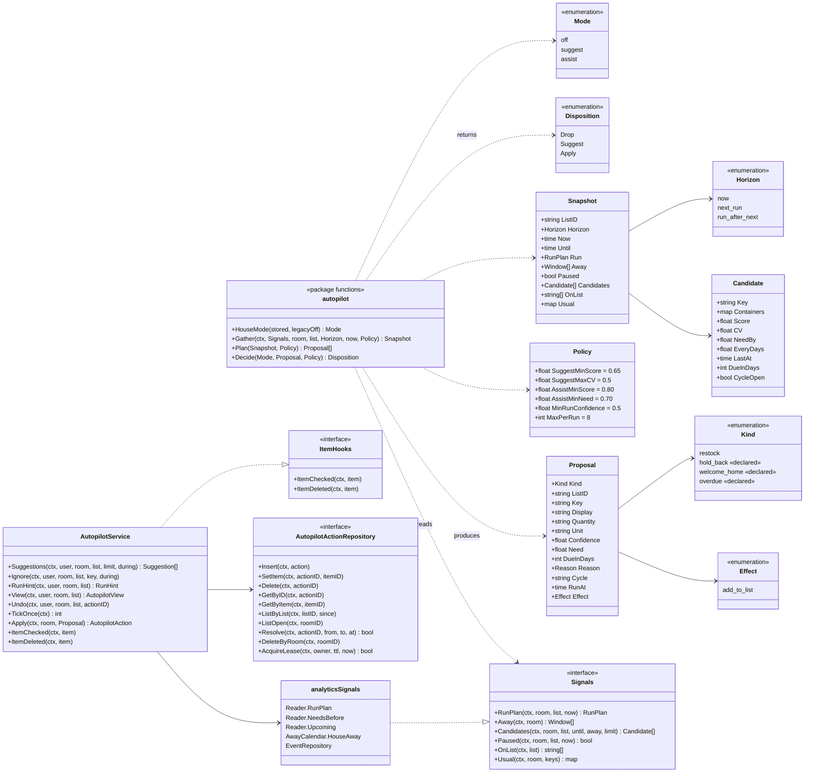

### 4. Deciding one proposal (`Decide`)

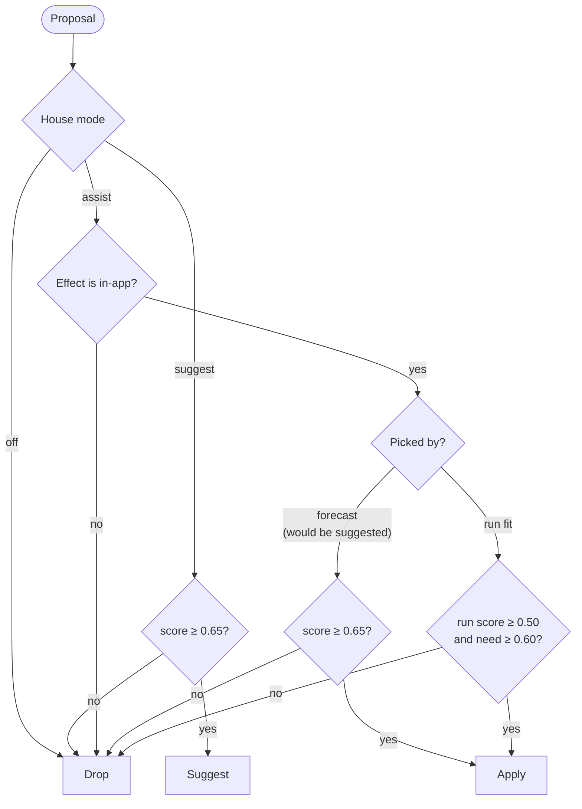

### 5. Planning one list (`Plan`: the shared candidate filters)

The run and away checks apply only to the run-based horizons. The slip's "now" horizon skips them, as today.

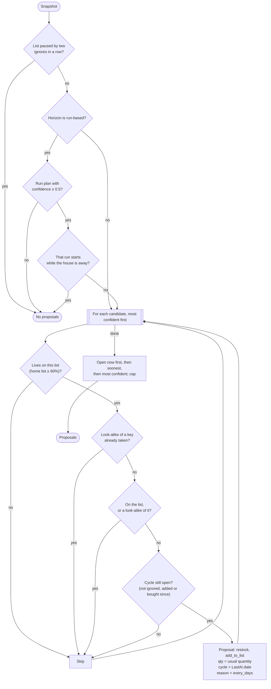

### 6. One tick (UML sequence)

Every instance runs the ticker. The lease keeps the work on one instance, and the unique action key makes a second write a no-op even if two instances race.

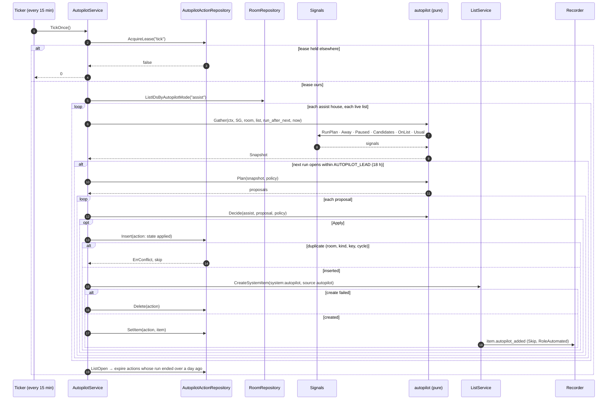

### 7. Outcomes: check, swipe-delete, Undo (UML sequence)

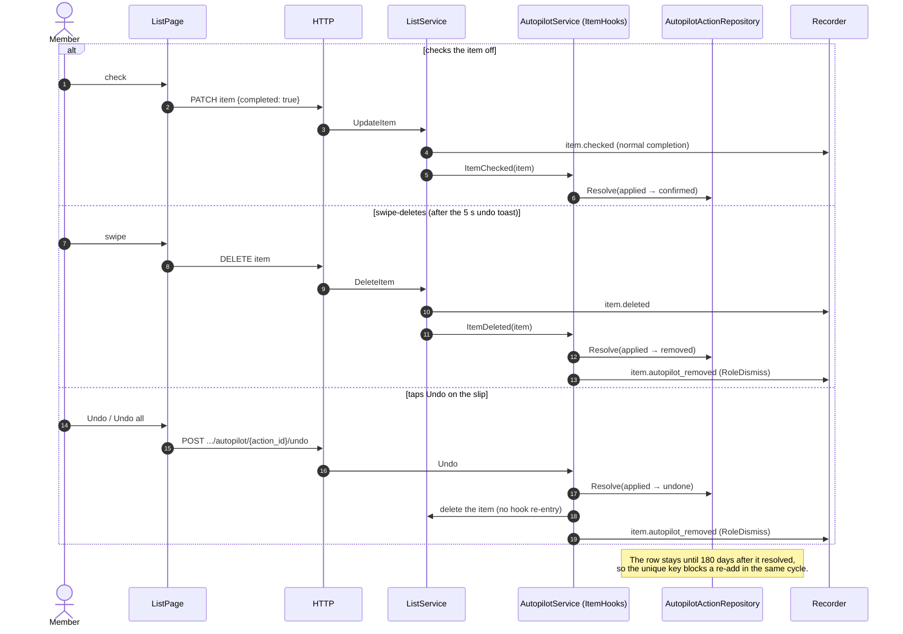

### 8. Action lifecycle (UML state machine)

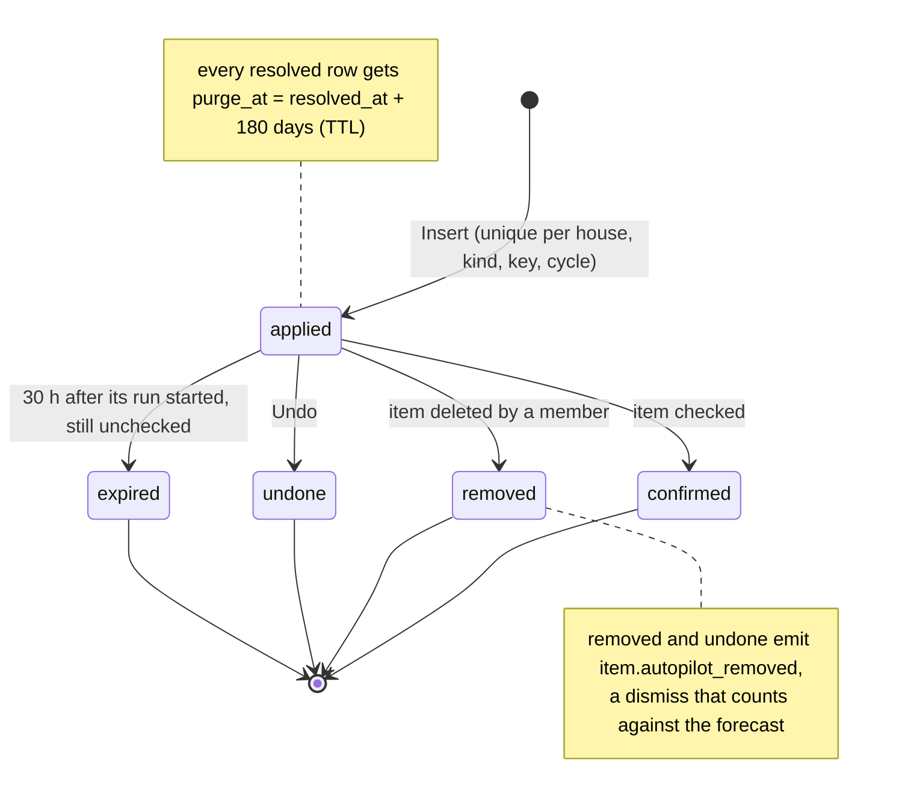

### 9. Keeping the forecast honest (`recomputeKey`)

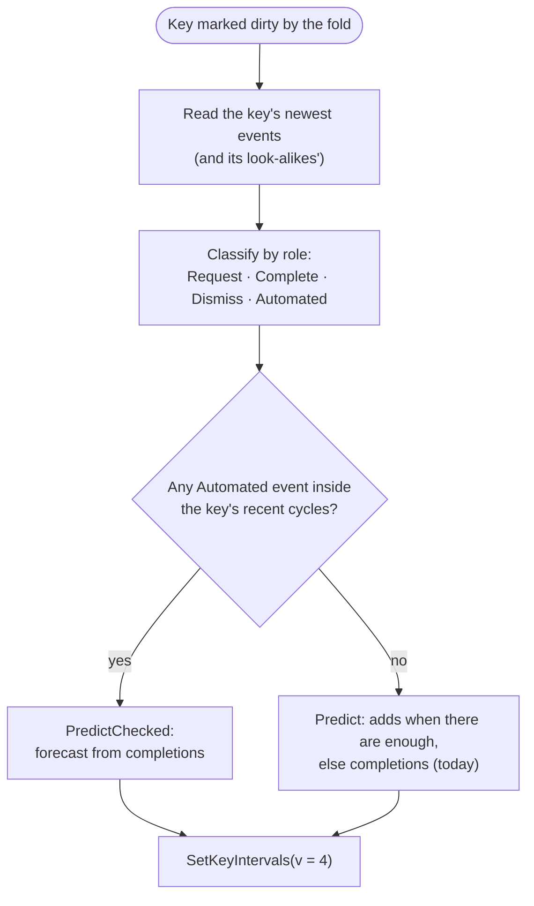

Why: on assist, nobody adds the thing by hand any more, so the add series would dry up and the forecast would decay (or, if autopilot adds counted, confirm itself). Completions keep coming either way.

### 10. Data model (`autopilot_actions`)

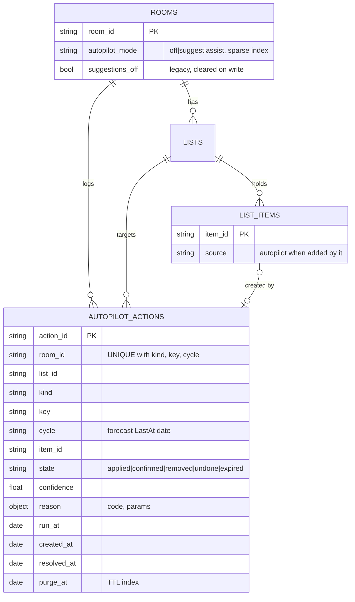

A separate `autopilot_state` collection holds the ticker lease (`_id: "tick"`, `owner`, `lease_until`).

### 11. List page (frontend flow)

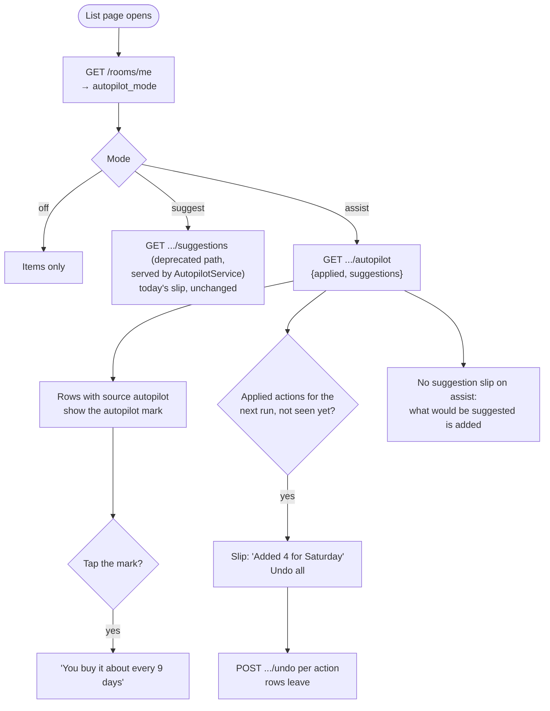

---

### Task 1: Modes

**Files:**
- Create: `backend/internal/autopilot/mode.go`, `mode_test.go`
- Modify: `backend/internal/models/room.go`, `backend/internal/store/repo.go` (`RoomRepository.SetAutopilotMode`, `ListIDsByAutopilotMode`; remove `SetSuggestionsOff`), `backend/internal/store/mongo/room_repo.go` (+ sparse index), `backend/internal/testutil/memstore/memstore.go`, `backend/internal/services/room_service.go` (`RoomSettings`), `backend/internal/http/handlers/room.go`
- Test: `autopilot/mode_test.go`, `handlers/autopilot_mode_test.go`, `store/mongo/mongo_integration_test.go`

**Interfaces:**
```go
type Mode string // ModeOff, ModeSuggest, ModeAssist
func ParseMode(s string) (Mode, bool)
func HouseMode(stored string, legacyOff bool) Mode
// models.Room: AutopilotMode string `bson:"autopilot_mode,omitempty" json:"-"`
// RoomRepository: SetAutopilotMode(ctx, roomID, userID, mode string, at time.Time) error  (clears suggestions_off)
//                 ListIDsByAutopilotMode(ctx, mode string, limit int) ([]string, error)
type RoomSettings struct{ DisplayName, Description *string; SuggestionsOff *bool; AutopilotMode *autopilot.Mode }
func (s *RoomService) UpdateRoomSettings(ctx, user, in RoomSettings) error
```
- [ ] Failing tests: `ParseMode` table (tolerates case and spaces; unknown → false); `HouseMode("", true)` = off, `("", false)` = suggest, `("assist", true)` = assist. Handler: `PUT /rooms/settings {autopilot_mode:"bogus"}` → 400; `{autopilot_mode:"assist"}` → 200, then `GET /rooms/me` → `autopilot_mode:"assist", suggestions_off:false`; `{suggestions_off:true}` reads back `off`; `{suggestions_off:false}` turns off → suggest and never downgrades assist. Mongo: setting a mode unsets `suggestions_off`; `ListIDsByAutopilotMode("assist")`; a non-member write → `ErrNotFound`.
- [ ] Implement; `house.settings_updated` lists `autopilot_mode`. Suggestions read `HouseMode(...) == ModeOff` in place of `room.SuggestionsOff` so behaviour is unchanged.
- [ ] `make check`, `make test-integration`. Commit `feat(rooms): autopilot mode as a house setting`.

### Task 2: One service

A move with no behaviour change: `SuggestionService` becomes `AutopilotService`.

**Files:** rename `services/suggestion_service.go` → `services/autopilot_service.go` (and its test), move `services/run_hint.go` methods onto it; modify `http/handlers/suggestions.go` (handlers take `*services.AutopilotService`, set the deprecation headers), `http/router/router.go` (route comments), `cmd/gracie-server/main.go`.

**Interfaces:**
```go
func NewAutopilotService(rooms, lists, items, reader, events, killSwitch SuggestionMode) *AutopilotService
func (s *AutopilotService) Suggestions(ctx, user, roomID, listID string, limit int, during string) ([]Suggestion, error) // was ForList
func (s *AutopilotService) Ignore(ctx, user, roomID, listID, key, during string) error
func (s *AutopilotService) RunHint(ctx, user, roomID, listID string) (RunHint, error) // was RunHintFor
```
- [ ] Port the suggestion and run-hint tests with only names changed; add `TestDeprecatedRoutesCarryHeader` (both headers on all three routes, bodies unchanged).
- [ ] Move the code; delete `SuggestionService`.
- [ ] `make check`. Commit `refactor(autopilot): fold suggestions into one autopilot service`.

### Task 3: Planner core and the shared pipeline (pure)

**Files:** create `autopilot/proposal.go`, `policy.go`, `filters.go`, `plan.go`, `signals.go`, `need.go` (+ tests), `autopilot/autopilottest/fake.go`, `services/autopilot_signals.go` (the `Signals` adapter over the real analytics reads); modify `services/autopilot_service.go` (`Suggestions` becomes Gather → Plan → Decide).

**Interfaces:** as in diagram 3, plus
```go
var DefaultPolicy = Policy{SuggestMinScore: 0.65, SuggestMaxCV: 0.5, AssistMinScore: 0.80, AssistMinNeed: 0.70, MinRunConfidence: 0.5, MaxPerRun: 8}
```
Where each horizon's candidates come from: `now` → `Reader.Upcoming` (today's query, unchanged); `next_run` → `Reader.Upcoming` with today's run-mode lookahead (house run interval, capped at 14 days), unchanged; `run_after_next` → `Reader.NeedsBefore(…, RunPlan.After.Start, HouseAway, …)`, so `Candidate.NeedBy` is `predict.NeedBy`. The run plan is `Reader.RunPlan`.
The filters move out of the service into `autopilot` unchanged in meaning: home list (`homeListShare` 0.6), one name per look-alike cluster, on the list or a look-alike of it, cycle still open (no ignore, add or check since `LastAt`; run-mode ignores only hide the key from run mode), paused after two ignores in a row within 14 days, ordering (open now, then soonest, then score). The adapter supplies `CycleOpen` and `Paused` from the event repository, as the service does today. `Plan` is diagram 5; `Decide` is diagram 4. Horizons: `now` (window open now), `next_run` (today's run-mode lookahead, capped at 14 days), `run_after_next` (Assist).
- [ ] Failing table tests: `TestDecideModesByBand` (off/suggest/assist × below suggest / between / above assist / high score but low need / non-in-app effect); `TestPlanSkipsOnListAndLookAlikes`; `TestPlanAwayNoAdds`; `TestPlanCycleIsLastAtDate`; `TestPlanNoRunNoProposals` (run horizons only); `TestPlanPausedNoProposals`; `TestSignalsAdapterReadsAnalytics` (memstore aggregates: the adapter returns `RunPlan`, `NeedsBefore` and `HouseAway` unchanged); `TestSuggestionsParityAcrossModes`.
- [ ] Move the filters; rewire `Suggestions`. The ported suggestion suite from Task 2 must still pass untouched.
- [ ] `make check`. Commit `feat(autopilot): pure planner and one candidate pipeline`.

### Task 4: Action log store (Mongo)

**Files:** create `models/autopilot_action.go`, `store/mongo/autopilot_repo.go`, `testutil/memstore/autopilot.go`, `store/mongo/autopilot_integration_test.go`; modify `store/repo.go`, `services/room_service.go`, `services/user_service.go` (delete with the house).

**Interfaces:** `AutopilotActionRepository` as in diagram 3; data as in diagram 10. `Insert` returns `derr.ErrConflict` on the unique key; `Resolve` is conditional on the `from` states and sets `purge_at`.
- [ ] Failing integration tests: `TestAutopilotActionUniqueKey`; conditional resolve (applied→confirmed true; undone→removed false); TTL index on `purge_at`; `DeleteByRoom`; the lease is exclusive between two owners. The memstore mirrors every rule.
- [ ] `make check`, `make test-integration`. Commit `feat(autopilot): durable action log with a unique action key`.

### Task 5: Executor and outcomes

**Files:** modify `services/autopilot_service.go` (+ test), `models/list_item.go` (`Source string json:"source,omitempty"`), `services/list_service.go` (`CreateSystemItem`, `UseItemHooks`), `services/analytics_events.go`, `analytics/registry.go` (`RoleAutomated`), `analytics/rollup.go`, `analytics/predict/forecast.go` (`PredictChecked`), `analytics/aggregate.go` (`ForecastVersion` 3 → 4).

Flows: diagrams 6 (apply path), 7, 8 and 9.
- [ ] Failing tests: `TestExecutorRefusesExternalEffects`; `TestApplyInsertsThenCreatesItem` (source `autopilot`, actor `system:autopilot`, only `item.autopilot_added`, no `item.added`); `TestApplyDuplicateIsNoop`; check → confirmed; `TestDeleteAutopilotItemMarksRemoved` (+ `item.autopilot_removed`); `TestRemovedNotReaddedSameCycle`; `TestAutomatedAddsKeepRhythm` (rollup: weekly checks, adds replaced by automated ones → series checked, still confident); `TestAssistTenCyclesStableRhythm` (a golden household); `TestAutopilotActorNotATurn` (`LastBy`/`Turns` never name `system:autopilot`). Rerun `TestGoldenWorld` with `-update` only if the version bump changes the pinned output, and review the diff.
- [ ] `make check`. Commits `feat(analytics): automated role, forecast from checks for automated keys` and `feat(autopilot): executor and outcome hooks`.

### Task 6: When it runs

**Files:** `services/autopilot_service.go` (ticker, view, undo), `http/handlers/autopilot.go` (+ test), `http/router/router.go`, `config/config.go` (`AUTOPILOT_TICK_EVERY` 15m, `AUTOPILOT_LEAD` 18h), `cmd/gracie-server/main.go`, `.env.example`.

```go
// GET  /rooms/{room_id}/lists/{list_id}/autopilot → {mode, applied: [...], suggestions: [...]}  (never applies)
// POST /rooms/{room_id}/lists/{list_id}/autopilot/{action_id}/undo → 204
```
The tick is diagram 6. It only visits houses that stored `assist`, and re-reads the house mode per house so a switch to off stops it at once. The view's `suggestions` come from the same pipeline (Decide → Suggest).
- [ ] Failing tests: `TestTickWritesOnlyInAssist`; `TestTickOutsideLeadDoesNothing`; `TestConcurrentTicksAddOnce` (two services, one store, parallel ticks); `TestTickExpiresStaleActions`; `TestTickSkipsHouseAway`; `TestViewNeverApplies`; `TestAssistFallbackIsSameItem`; `TestUndoMarksUndoneAndDismisses`; handler auth (403 for another house, 404 for an unknown action).
- [ ] `make check`. Commit `feat(autopilot): lease-based ticker, read view and undo`.

### Task 7: Frontend settings

**Files:** `frontend/src/pages/RoomSettings.tsx` (+ test), `api/types.ts`, `api/endpoints.ts`; a `Segmented` primitive in `components/ui/` if none exists (reference page, DESIGN.md, `/dev/ui`).
- [ ] Failing test: the three options render as a radio group; picking Assist PUTs `{autopilot_mode:"assist"}` and shows "Adds things to your lists before you shop. You can always undo. It never buys or books anything."
- [ ] `make check`. Commit `feat(settings): three-way autopilot control`.

### Task 8: Frontend list

**Files:** `components/ItemRow.tsx`, `pages/ListPage.tsx`, a new `AutopilotSlip`, `styles.css` token(s) for the autopilot mark, `docs/design-system/index.html`, `DESIGN.md`, the MSW mock (autopilot items + endpoint). Flow: diagram 11. The List page keeps calling the deprecated suggestion routes in this PR; moving it fully onto `GET …/autopilot` (and then removing those routes) is a follow-up.
- [ ] Failing tests: an item with `source:"autopilot"` shows the mark; tapping it shows the reason; the slip reads "Added 4 for Saturday" once per run; Undo all posts one undo per action and removes the rows; suggest mode keeps today's slip.
- [ ] Check it in `VITE_MOCK_TRIPS=1 pnpm dev`. `make check`. Commit `feat(lists): autopilot mark, reason and the added-for slip`.

### Task 9: Eval

**Files:** create `autopilot/replay.go` (+ test); modify `cmd/suggest-eval/main.go` (`autopilot` subcommand).

`func Replay(events []analytics.Event, p Policy, lead time.Duration) ReplayReport` with `Precision()`, `Recall()` and `RemovalsPerWeek()`. At each past run minus the lead, plan from the data before that time through the same filters. An auto-added item counts as a hit when it was checked in that run, and as a removal otherwise.
- [ ] Failing tests on the golden households: the weekend shopper (high precision, low removals) and the irregular top-up house (Assist adds almost nothing).
- [ ] The subcommand takes the same flags as `backtest`: `-synthetic` (golden households) and `-away-from-trips`.
- [ ] Run on the dev dataset and on `-synthetic`, and sweep `AssistMinScore` / `AssistMinNeed`. **Gate:** pick the loosest bar with precision ≥ 0.85 and removals ≤ 1 per week. If no bar meets it, keep 0.80 / 0.70, say so in the PR, and Jan decides whether Assist ships in the settings control. The numbers go in the PR description.
- [ ] `make check`. Commit `feat(autopilot): suggest-eval autopilot replay`.

### Task 10: Docs

`docs/features/autopilot.md` (modes table, invariants, the deprecated routes and their successor, eval gate, these diagrams) plus a row in `docs/features/README.md`. Update `suggestions.md` (now served by `AutopilotService`), `lists.md` and `backend/CLAUDE.md` (the stateless-suggestions invariant now names the action log; the service list). Commit `docs(autopilot): feature note and invariants`.

## Follow-ups (not in this PR)

- Move the List page onto `GET …/autopilot` for suggestions and the run hint, then delete the three deprecated routes.

## Out of scope

Holding perishables back before a trip, the welcome-home shop and overdue chores (the kinds are declared only), push notifications, and any external effect.
