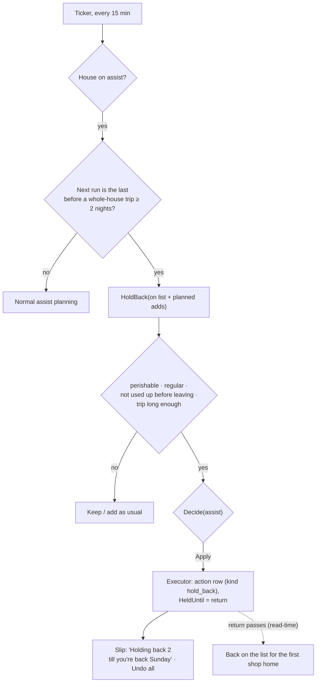
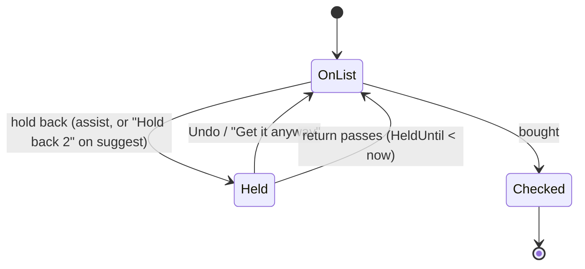
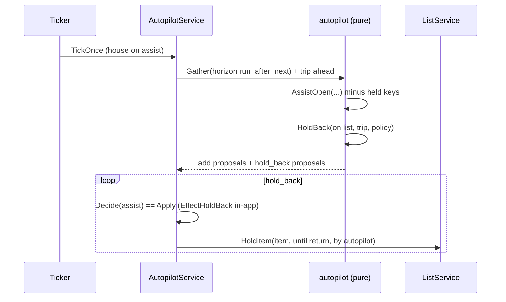

# Autopilot: hold back before a trip — Implementation Plan

> **For agentic workers:** REQUIRED SUB-SKILL: Use superpowers:subagent-driven-development (recommended) or
> superpowers:executing-plans to implement this plan task-by-task. Steps use checkbox (`- [ ]`) syntax.

**Status:** plan, awaiting Jan's approval. **Depends on** the autopilot engine (PR #29). Pairs with
[welcome home](2026-10-17-autopilot-welcome-home.md): what is held back comes back for the first shop home.

**Goal:** Don't buy milk and bananas on the last shop before a trip, only to throw them out. Before the whole house
goes away, autopilot holds back the fresh things it wouldn't get through in time: "Holding back milk and bananas
till you're back Sunday."

`autopilot.KindHoldBack` is already declared for this.

## Modes

| Mode | On the last shop before a trip |
|---|---|
| `off` | Nothing. |
| `suggest` | A **hold-back slip** above the items: "Away from Thursday. Hold back milk and bananas?", a key **"Hold back 2"** and an X. Nothing changes until someone taps. |
| `assist` | Autopilot doesn't add them, and holds back the ones already on the list. The autopilot slip reads **"Holding back 2 till you're back Sunday"** with Undo all. |

Only when the **whole house** will be away for **at least 2 nights**, and only for the **last run before leaving**
(the run plan's next run starts before the trip, and the one after it would fall inside it).

## What "held back" means

A held item **stays on the list**. It moves into a small "Held till you're back · Sunday" group under the items, in
muted ink, not counted in "N to get", and the list's run detection ignores it. Nothing is deleted.

- **New field:** `ListItem.HeldUntil *time.Time` (the return), with `HeldBy` (`system:autopilot` or a member).
- **It ends by itself.** A held item whose `HeldUntil` has passed is just an item again, read-time, with no job.
  So on the way home the held things are already back on the list, ready for the first shop:
  [welcome home](2026-10-17-autopilot-welcome-home.md) lists them in its slip and doesn't add them twice.
- **Undo** clears `HeldUntil`. A person can also tap a held row's "Get it anyway".
- **Reversible and in-app:** a new effect, `EffectHoldBack`, added to `Effect.InApp()`. The executor writes the
  action row first (unique room · kind · key · trip start), then sets `HeldUntil`.

This is the first time autopilot changes something a person wrote. It doesn't remove or edit it: it sets one
reversible flag, marked with the bell, with a reason and Undo. That is why holding is a flag and not a delete.

## Which things

A thing on the list (or one assist would add for that run) is held back when all of these hold:
- it is **perishable**: Produce, Eggs & Dairy, Meat & Seafood or Grains & Bakery, with a rhythm of 14 days or less
  (`Policy.Perishable`, shared with welcome home);
- it is a **regular buy** on this list (≥ 4 purchases, a learned rhythm);
- the house **wouldn't get through it before leaving**: the home time between the run and departure is less than
  60% of its rhythm (`Policy.HoldBackShare`);
- the trip is **long enough to spoil it**: at least 3 days or half its rhythm.

So a weekly milk bought two days before a week away is held back; bread for the day before leaving isn't (eaten
first); rice isn't (not perishable); a one-off cake isn't (not a regular buy).

## Architecture

- **Pure:** `autopilot.HoldBack(onList, planned, trip, events, policy)` returns `KindHoldBack` proposals (with the
  item id for things already on the list). `AssistOpen` drops a key `HoldBack` would hold, so assist never adds what
  it would then hold back.
- **Store:** `ListItem.HeldUntil`, `HeldBy`; `ListItemRepository.SetHeld(itemID, until, by)` (conditional on the
  item still being unchecked). No new collection.
- **Analytics:** a hold is not a dismiss. `item.held_back` and `item.hold_released {via: undo|anyway|returned}` are
  new events with `RoleAutomated` for autopilot's holds, so a held week doesn't teach the forecast "not needed".
- **Suggest mode:** `GET …/autopilot` returns `hold_back: {leaves_at, return_at, items}`; "Hold back 2" calls
  `POST …/autopilot/hold` with the item ids (the person's own action, `HeldBy` = them), X records an ignore per key.

## Tasks

### Task 1: Hold an item (store and list service)
**Files:** `models/list_item.go`, `store/mongo/list_item_repo.go`, `testutil/memstore`, `services/list_service.go`;
tests (memstore and integration).
- [ ] `HeldUntil`, `HeldBy`; `SetHeld` / `ClearHeld` (unchecked only); held items still returned by the list read.
- [ ] Events `item.held_back`, `item.hold_released` registered (automated role for autopilot).
- [ ] Tests: `TestHoldThenUndo`, `TestHoldEndsAtReturn` (read-time), `TestHoldCheckedItemRefused`, integration
  `TestListItemHeldRoundTrip`.

### Task 2: `HoldBack` (pure)
**Files:** `backend/internal/autopilot/holdback.go` (+ test), `policy.go` (`HoldBackShare`, `HoldMinNights`),
`proposal.go` (`EffectHoldBack`), `signals.go` (the trip ahead on the snapshot).
- [ ] The four rules, using home time between the run and departure.
- [ ] `AssistOpen` skips keys `HoldBack` holds.
- [ ] Tests: `TestHoldBackWeeklyMilkBeforeWeekAway`, `TestNoHoldBackBreadDayBefore`, `TestNoHoldBackPantry`,
  `TestNoHoldBackOneOff`, `TestNoHoldBackShortTrip`, `TestNoHoldBackSoloTrip`, `TestNoHoldBackNotLastRun`,
  `TestAssistDoesNotAddWhatItHolds`.

### Task 3: Executor, ticker, view, routes
**Files:** `services/autopilot_executor.go`, `autopilot_ticker.go`, `autopilot_service.go`,
`http/handlers/autopilot.go`, `router.go`; tests.
- [ ] Executor applies `EffectHoldBack` (row first, then `SetHeld`); Undo clears the hold.
- [ ] `View`: `hold_back` on suggest; held actions on assist. `POST …/autopilot/hold` for suggest's one tap.
- [ ] Tests: `TestTickHoldsBackOncePerTrip`, `TestUndoHoldBack`, `TestHoldRouteOnlyOwnHouse` (403),
  `TestExecutorStillRefusesExternalEffects`.

### Task 4: Eval
**Files:** `backend/internal/autopilot/replay/holdback.go` (+ test), `cmd/suggest-eval` (`autopilot -holdback`).
- [ ] On the golden households, every last run before a whole-house trip: what would be held, and whether the house
  bought it in that run anyway. The golden houses don't model throwing food out yet, so this checks the rules fire
  where they should and nowhere else (no holds on solo trips, short trips, pantry, one-offs), not that they help.
- [ ] **Real-data gate, before assist holds anything:** ship hold back to **suggest only** first, and turn it on for
  assist once the hold-back slip's acceptance rate on real houses is ≥ 60% over at least 20 slips
  (`suggest-eval autopilot -holdback` on the database reads `item.held_back` with `HeldBy` a member against
  ignores). Until then assist only skips its own adds (it never adds what it would hold) and holds nothing a person
  wrote.

### Task 5: Frontend
**Files:** `frontend/src/pages/ListPage.tsx`, `components/ItemRow.tsx` (held variant),
`components/HoldBackSlip.tsx` (suggest), `components/AutopilotSlip.tsx` (copy), `lib/autopilot.ts`, mocks; tests.
- [ ] "Held till you're back · Sunday" group under the items: muted rows with the bell stamp and "Get it anyway".
- [ ] Suggest: `HoldBackSlip` (the suggestion slip's look: key "Hold back 2", X). One slip at a time.
- [ ] Assist: "Holding back 2 till you're back Sunday" with Undo all.
- [ ] Mock: `?mockAway=leaving` seeds a trip starting in two days.
- [ ] Tests: `ListPage.holdback.test.tsx` (group shows and isn't counted; Get it anyway; suggest one tap; assist
  copy and Undo all).

### Task 6: Docs
- [ ] `docs/features/autopilot.md`, `lists.md` (held items), `trips.md`, `analytics.md` (the two events),
  DESIGN.md (the held group, the slip), the store guide (the new fields).

## Open questions for Jan
1. **May assist hold what a person wrote?** This plan says yes (it's a reversible flag, marked, with Undo), but only
   after the real-data gate in Task 4. The alternative: assist only ever skips its own adds. Recommendation: the
   gate, then yes.
2. **Ship with welcome home?** Recommendation: yes, together (hold back first in the PR, since welcome home reads
   held items), one "trips" release.

## Out of scope
- Freezing things, or shelf life learned per item.
- Anything outside Bauhouse (cancelling a delivery, messaging).
