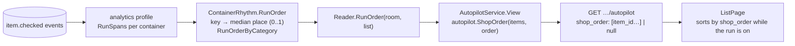
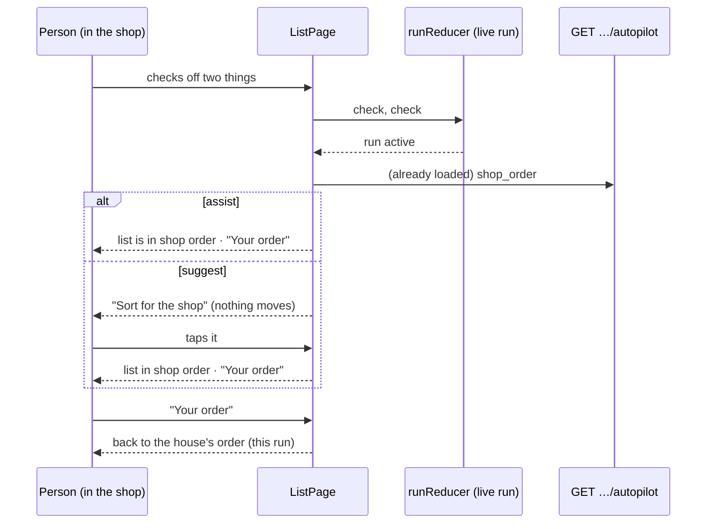
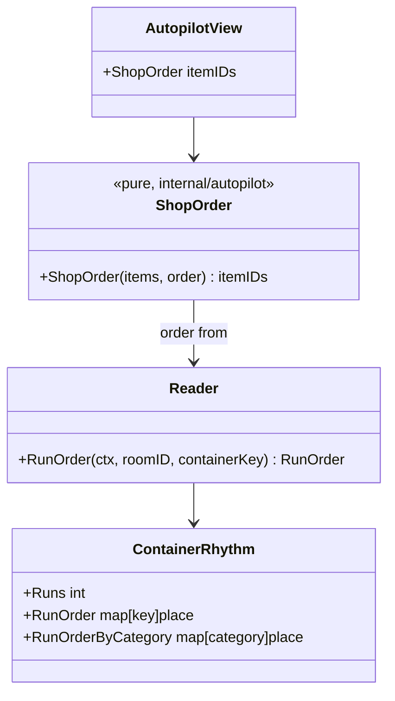

# Autopilot: shop order — Implementation Plan

> **For agentic workers:** REQUIRED SUB-SKILL: Use superpowers:subagent-driven-development (recommended) or
> superpowers:executing-plans to implement this plan task-by-task. Steps use checkbox (`- [ ]`) syntax.

**Status:** plan, awaiting Jan's approval. **Depends on** the autopilot engine (PR #29: modes, `AutopilotService`,
`GET …/autopilot`).

**Goal:** On shop day the list puts itself in the order the house walks the shop, so nobody zig-zags. Bauhouse
already sees every run's check-offs in order; this learns each thing's usual place in the run from them and sorts
by it.

**Why it is safe:** it only changes how the list is shown, for this run. It never adds, removes or rewrites
anything, and never touches the house's own order (`ListItem.Order`, set by dragging).

## Modes

The modes do not mix (as in PR #29):

| Mode | What happens on shop day |
|---|---|
| `off` | Nothing. The list keeps the house's order. |
| `suggest` | Offers: once a run starts, a quiet text button **"Sort for the shop"** sits above the items. Nothing moves until someone taps it. |
| `assist` | Does it: once a run starts, the list is already in shop order, with a quiet **"Your order"** text button to switch back. |

Either way the choice lasts for this run only (`sessionStorage`, keyed by list and run start), and checked-off
items still drop to the bottom as they do today. Grouped by category, the **sections** follow the shop order too
(each section's place is the median place of its things).

## How the order is learned

- **Where:** in the house profile, beside the run rhythm it already keeps per container
  (`analytics.ContainerRhythm`, built in `analytics/profile.go` from `predict.RunSpans`). It is a generic stat ("the
  order completions usually happen in within a run"), so analytics stays feature-agnostic.
- **What:** for each run span on the list, every key checked in it gets a place `p = rank / (n − 1)` (0 = first,
  1 = last; `n` = things checked in that run). A key's **position** is the median of its places over its last 12
  runs, kept only once it has been seen in at least 3 runs. Stored as `ContainerRhythm.RunOrder map[key]float64`,
  capped at the 200 keys seen most recently so the profile stays small.
- **Category fallback:** a thing with no position yet (new, or seen in fewer than 3 runs) takes its category's
  median position (`RunOrderByCategory map[category]float64`). With neither, it keeps its place relative to its
  neighbours in the house's order.
- **When it is shown:** only once the list has at least 4 runs and positions for at least half of what is on it
  (otherwise it would sort a few things and scramble the rest).

## Architecture

- **`autopilot.ShopOrder` (pure):** takes the list's unchecked items (`item_id`, normalized key, category, house
  order) and the run order; returns item ids in shop order, or nil when the "when it is shown" rule fails. Stable:
  ties keep the house's order.
- **The List page reads `GET …/autopilot` in suggest mode too.** That is the first half of PR #29's follow-up (it
  now reads it only on assist); the deprecated `…/suggestions` and `…/run-hint` routes stay until the second half.

## Tasks

### Task 1: Learn the run order (analytics)
**Files:** `backend/internal/analytics/profile.go`, `predict/rhythm.go` (a `RunPlaces` helper), `reader.go`; tests.
- [ ] `predict.RunPlaces(span, keys)`: places 0..1 within one run; ties (same second) share the mean rank.
- [ ] `ContainerRhythm.RunOrder` and `RunOrderByCategory` (median of the last 12 runs, min 3 runs, 200-key cap).
- [ ] `Reader.RunOrder(ctx, roomID, containerKey)`.
- [ ] Tests: `TestRunPlacesNormalizes`, `TestRunOrderNeedsThreeRuns`, `TestRunOrderCapsKeys`,
  `TestRunOrderCategoryMedian`; the profile stays under its size budget on `big-family`.

### Task 2: A shop path in the golden households
**Files:** `backend/internal/testutil/households/households.go`.
- [ ] Each house gets a shop path: every category a place in the walk, every staple a place within its category
  (seeded). `shop` checks things off in path order with a little noise (a swap now and then), instead of at
  random within 25 minutes.
- [ ] Draw the same number of random numbers as today so the rest of the year is unchanged, then re-run
  every benchmark (suggestions, assist, shop order) and record any drift in the QA note.

### Task 3: `autopilot.ShopOrder` and the view
**Files:** `backend/internal/autopilot/shoporder.go` (+ test), `services/autopilot_service.go`,
`services/autopilot_signals.go`, `http/handlers/autopilot.go`.
- [ ] Pure `ShopOrder` with the fallback chain and the "when it is shown" rule.
- [ ] `View` adds `shop_order` (nil on off; on suggest and assist alike, since the page decides how to offer it).
- [ ] Tests: `TestShopOrderUsesPositions`, `TestShopOrderCategoryFallback`, `TestShopOrderKeepsHouseOrderOnTies`,
  `TestShopOrderNeedsCoverage`, `TestViewShopOrderOffIsNil`.

### Task 4: Eval
**Files:** `backend/internal/autopilot/replay/shoporder.go` (+ test), `cmd/suggest-eval` (`autopilot -order`).
- [ ] At each past run, learn the order from earlier runs only, sort what was checked in it, and score it against
  the real check order: **Spearman's ρ** per run, averaged. Baselines: the house's own order and category order.
- [ ] **Ship bar:** mean ρ ≥ 0.6 and at least 0.15 above the better baseline on the golden households and the
  five hold-out seeds. Pinned by `TestGoldenShopOrderMeetsBar` with a ratcheted floor.

### Task 5: Frontend
**Files:** `frontend/src/pages/ListPage.tsx`, `lib/autopilot.ts`, `api/types.ts`, `mocks/browser.ts`; tests.
- [ ] Read `GET …/autopilot` on suggest as well as assist.
- [ ] While the live run is on (`runReducer`): assist sorts by `shop_order` and shows "Your order"; suggest shows
  "Sort for the shop". Both are `Button kind="text"`, on the sheet above the items, no new primitive.
- [ ] Rows move with the existing reorder animation (FLIP via the sortable list), and only once, when the run
  starts or the button is tapped, never while someone is mid-check.
- [ ] Dragging a row while in shop order switches back to the house's order first (dragging edits the house's
  order, so it must be the order on screen).
- [ ] Grouped view: sections in shop order.
- [ ] Tests: `ListPage.shopOrder.test.tsx` (assist sorts on run start; suggest waits for the tap; "Your order"
  restores; off shows nothing; drag switches back). Mock: `?mockRun=1` starts a run.

### Task 6: Docs
- [ ] `docs/features/autopilot.md` (shop order), `analytics.md` (`RunOrder`), `lists.md`, DESIGN.md (the two text
  buttons), the QA note with the benchmark.

## Open questions for Jan
1. **Start of a run only, or shop day?** This plan sorts once a run is detected (two check-offs). Sorting from the
   moment the list is opened in the predicted run window would help the first aisle too, but would sort lists
   opened at home on shop day. Recommendation: run start.
2. **Learn per list or per house?** Per list (the groceries list and the hardware list are different shops).

## Out of scope
- Several shops per list (the order is a blend of them; a later step could cluster runs by order).
- Writing the learned order into `ListItem.Order`.
