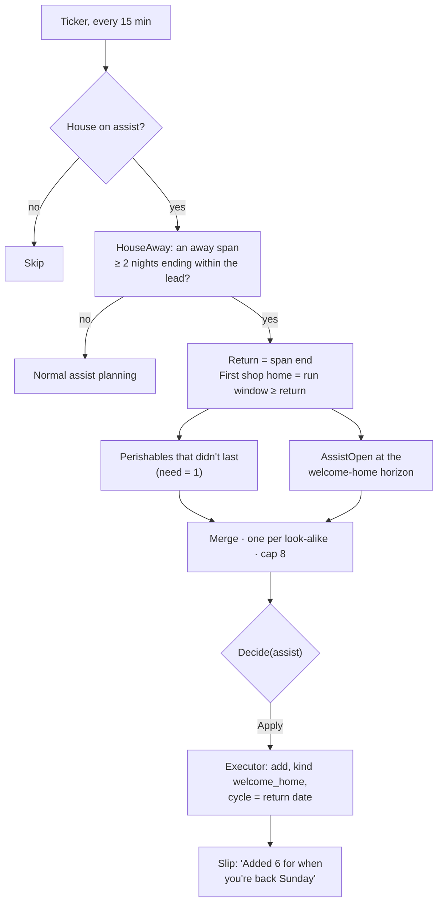
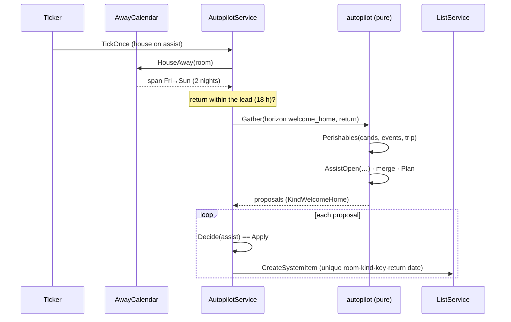
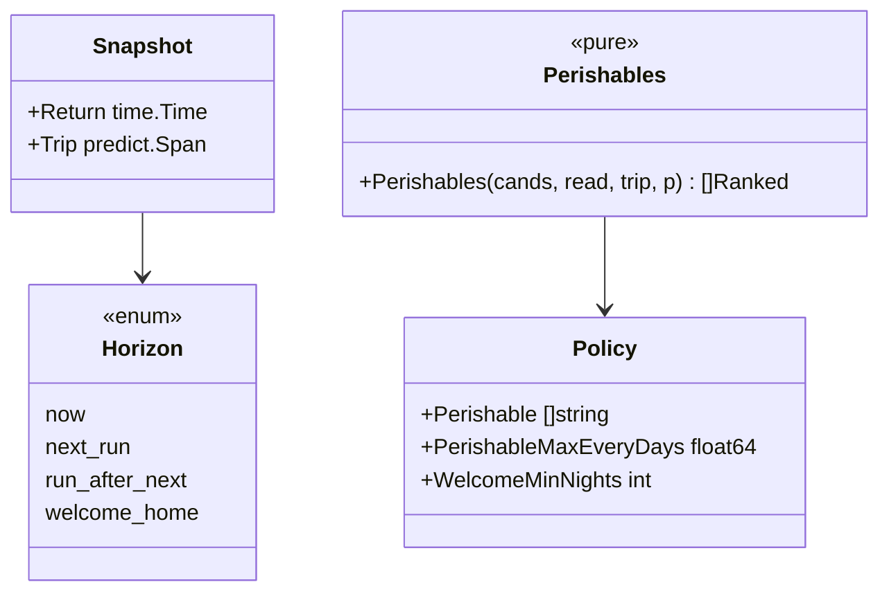

# Autopilot: welcome home — Implementation Plan

> **For agentic workers:** REQUIRED SUB-SKILL: Use superpowers:subagent-driven-development (recommended) or
> superpowers:executing-plans to implement this plan task-by-task. Steps use checkbox (`- [ ]`) syntax.

**Status:** plan, awaiting Jan's approval. **Depends on** the autopilot engine (PR #29). Pairs with
[hold back](2026-10-17-autopilot-hold-back.md): what is held back before a trip comes back here.

**Goal:** When the whole house comes back from a trip, the fridge is empty. The evening before they're back,
autopilot readies the groceries list for the first shop home: "Added 6 for when you're back Sunday."

**What already happens, and what doesn't:** assist already plans around trips: the run plan steps over away time,
forecasts pause while nobody is home, and nothing is added while the house is away. What's missing:
- **Timing.** The first shop after a trip is usually the day you get back, not when the usual rhythm says. Today's
  ticker plans 18 h before the *predicted* run, which can be days late.
- **Perishables.** Home-time forecasts assume the milk waited for you. It didn't: fresh things bought before a
  trip are gone or spoiled when you return, so they are needed now, whatever their rhythm says.

`autopilot.KindWelcomeHome` is already declared for this.

## Modes

| Mode | When the house is about to be back |
|---|---|
| `off` | Nothing. |
| `suggest` | The evening before the return, one **welcome-back slip** on the list: "Back Sunday? 6 usual things to restock", the names, a key **"Add 6"** and an X. One tap adds them all; nothing changes until then. |
| `assist` | Adds them the evening before, marked with the bell like any autopilot add, and the autopilot slip reads **"Added 6 for when you're back Sunday"** with Undo all. |

Only when the **whole house** is away for **at least 2 nights** (`AwayCalendar.HouseAway`, the same rule assist
already uses). A solo trip leaves someone at home, so the fridge isn't empty.

## What gets added

The return is the end of an away span; "the first shop home" is the first run window on or after it (the return
day if the house usually shops that day of the week or the next morning, else the run plan's next run, whichever is
sooner, capped at 2 days after the return).

Three picks, one name per look-alike, at most `MaxPerRun` (8), most needed first:
1. **Held back** before the trip ([hold back](2026-10-17-autopilot-hold-back.md)): they come back off hold at the
   return by themselves, so nothing to add; they count toward the slip's names.
2. **Perishables that didn't last:** a regular buy (≥ 4 purchases on this list, run score ≥ the run-fit bar) in a
   perishable category, whose last purchase was before the trip, when the trip lasted at least 3 days or half its
   rhythm. Need = 1.
3. **The usual restock:** what assist would add for that run anyway (`AssistOpen` at the welcome-home horizon:
   forecast picks and run-fit picks).

**Perishable** is a policy list of categories: Produce, Eggs & Dairy, Meat & Seafood, Grains & Bakery
(`Policy.Perishable`). Bread is fresh; flour is in Grains & Bakery too, so a perishable pick must also have a rhythm
of 14 days or less.

## Architecture

- **A new horizon, `welcome_home`.** `Gather` reads the away spans, finds a span of at least `WelcomeMinNights`
  ending within the lead, and sets the run to "the first shop home". It reuses `AssistOpen` for the usual restock
  and adds `Perishables`.
- **Cycle** is the return date, so the executor's unique index (room · kind · key · cycle) adds each thing once per
  return however often the ticker runs. Normal assist planning for the same run skips a key already on the list,
  so it never adds the same thing twice.
- **Suggest mode** gets the welcome-back slip from `GET …/autopilot` (`welcome: {return_at, items}`). "Add 6"
  creates the items with `source: 'suggestion'` and records `item.suggestion_accepted` for each, as one tap on
  today's slip does; X records one ignore per item (so a house that never wants this stops seeing it).

## Tasks

### Task 1: The welcome-home horizon (pure)
**Files:** `backend/internal/autopilot/welcome.go` (+ test), `signals.go`, `policy.go`, `proposal.go`.
- [ ] `HorizonWelcomeHome`; `Gather` finds the return and the first shop home (with the 2-day cap).
- [ ] `Perishables` and the merge; `Plan` gives `KindWelcomeHome` proposals with `RunAt` = the first shop home and
  reason `{code: "welcome_home", params: {days_away}}`.
- [ ] Tests: `TestWelcomeHomeNeedsWholeHouseAway`, `TestWelcomeHomeMinNights`, `TestPerishableAfterLongTrip`,
  `TestPantryFollowsHomeTime`, `TestFlourIsNotPerishable` (rhythm cap), `TestWelcomeHomeOnePerLookAlike`,
  `TestWelcomeHomeCapsAtMaxPerRun`.

### Task 2: Ticker and view
**Files:** `services/autopilot_ticker.go`, `autopilot_service.go`, `http/handlers/autopilot.go`; tests.
- [ ] The ticker plans `welcome_home` before normal planning when a return is within the lead.
- [ ] `View` returns `welcome` on suggest (the slip) and the applied actions on assist (kind shown in the slip).
- [ ] Tests: `TestTickWelcomeHomeAddsOncePerReturn`, `TestTickWelcomeHomeSkipsSoloTrip`,
  `TestWelcomeThenNormalRunNoDoubleAdd`, `TestViewWelcomeOnSuggestOnly`.

### Task 3: Golden households
**Files:** `backend/internal/testutil/households/households.go`.
- [ ] Perishable staples (a `fresh` flag) are thrown out when the house is away longer than their rhythm or 3 days:
  their next need is the return, not home time after the last buy. Today every staple waits for the house.
- [ ] Re-run every benchmark; record drift in the QA note.
- [ ] **Honesty note:** this teaches the synthetic houses the very rule we are testing, so the golden score shows
  the code does what we meant, not that houses behave this way. Check `suggest-eval autopilot -welcome` on real
  data before turning it on for assist.

### Task 4: Eval
**Files:** `backend/internal/autopilot/replay/welcome.go` (+ test), `cmd/suggest-eval` (`autopilot -welcome`).
- [ ] For every whole-house away span of 2+ nights: plan at return minus the lead from earlier events only, score
  against the first run after the return (within 3 days). Precision, open recall, F1, removals per return.
- [ ] **Ship bar:** the same gate as assist (precision ≥ 75%, F1 ≥ 70%) on `frequent-travellers` and
  `weekend-couple` and the hold-out seeds, plus "no worse than plain assist for that run".

### Task 5: Frontend
**Files:** `frontend/src/components/AutopilotSlip.tsx`, `lib/autopilot.ts` (`welcomeLine`),
`components/WelcomeSlip.tsx` (suggest), `pages/ListPage.tsx`, mocks; tests.
- [ ] Assist: the autopilot slip reads "Added 6 for when you're back Sunday" for welcome-home actions.
- [ ] Suggest: `WelcomeSlip`, the suggestion slip's look (a key, an X), with "Back Sunday? 6 usual things to
  restock" and the names on one line. One slip at a time: it replaces the suggestion slip until it is answered.
- [ ] Mock: `?mockAway=returning` seeds a trip ending tomorrow.
- [ ] Tests: `ListPage.welcome.test.tsx` (assist copy; suggest Add 6 adds six and records accepts; X ignores).

### Task 6: Docs
- [ ] `docs/features/autopilot.md`, `trips.md` (trips now shape the list), DESIGN.md (the welcome slip), the QA note.

## Open questions for Jan
1. **Which list?** This plan readies the house's busiest grocery list (the list with the most runs). A house with two
   grocery lists gets one welcome. Recommendation: the busiest list only.
2. **Perishable by category or learned?** Categories now (simple, explainable). Later the shelf life could be learned
   from how often fresh things are bought again right after a trip.

## Out of scope
- Trips where only some members travel (someone is home).
- Telling anyone outside Bauhouse (no messages, no orders).
